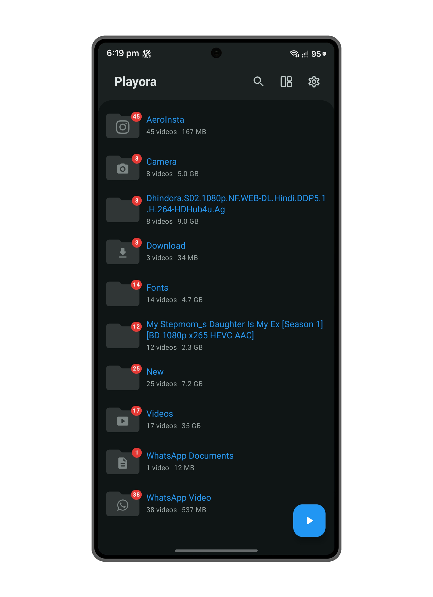
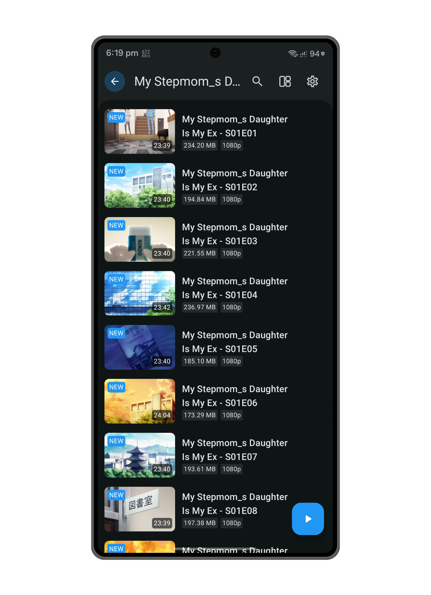
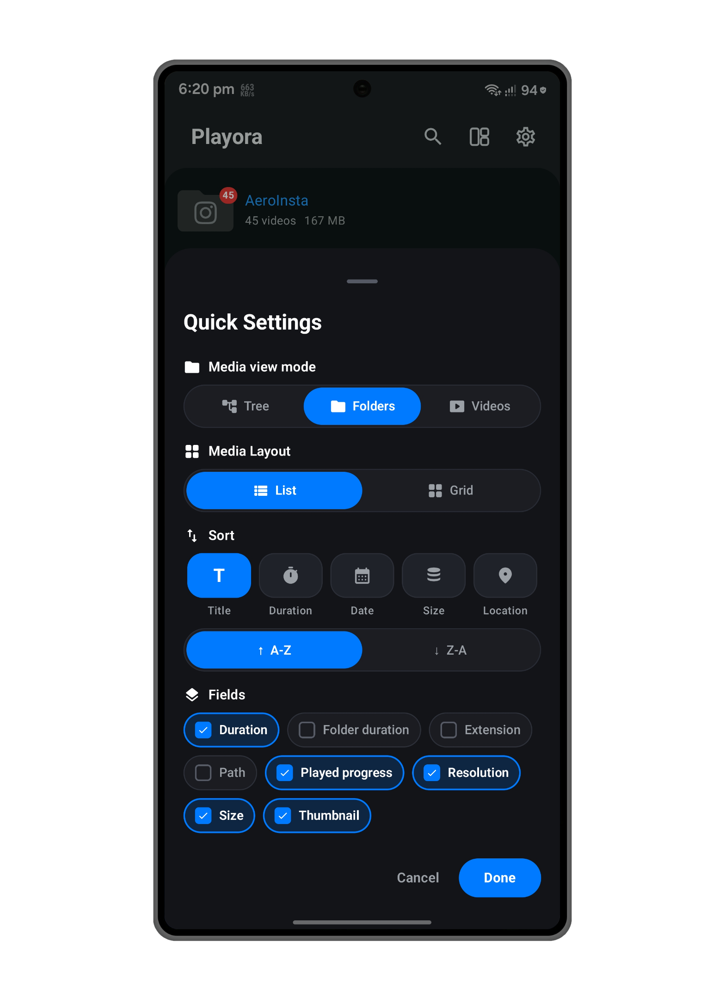
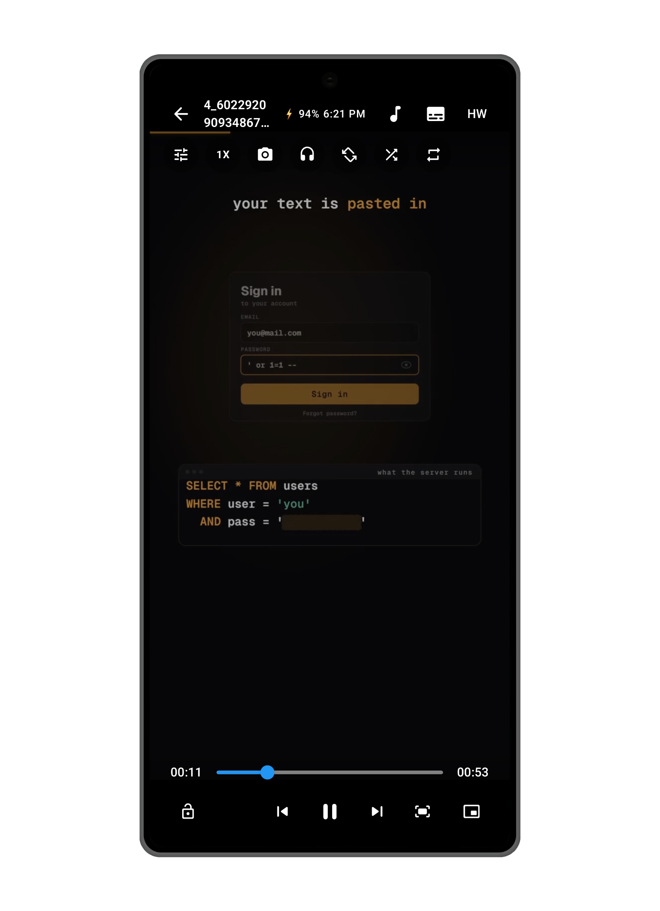
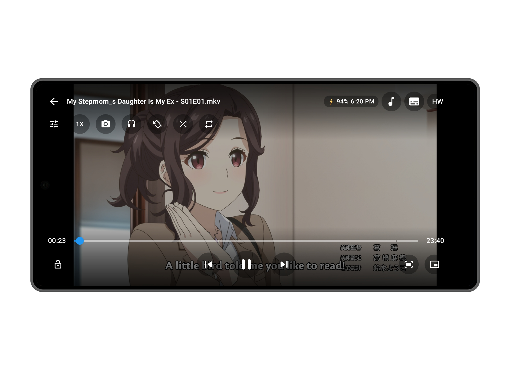
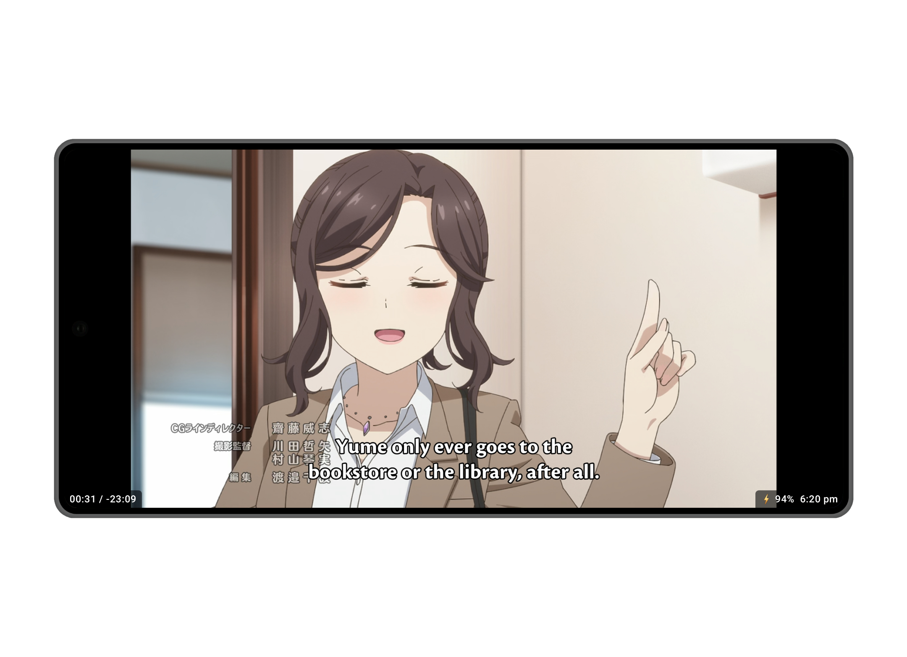
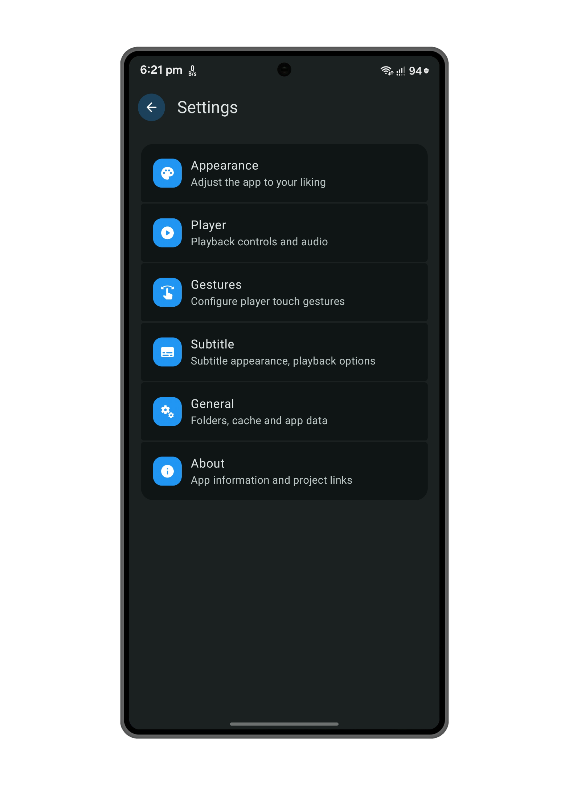
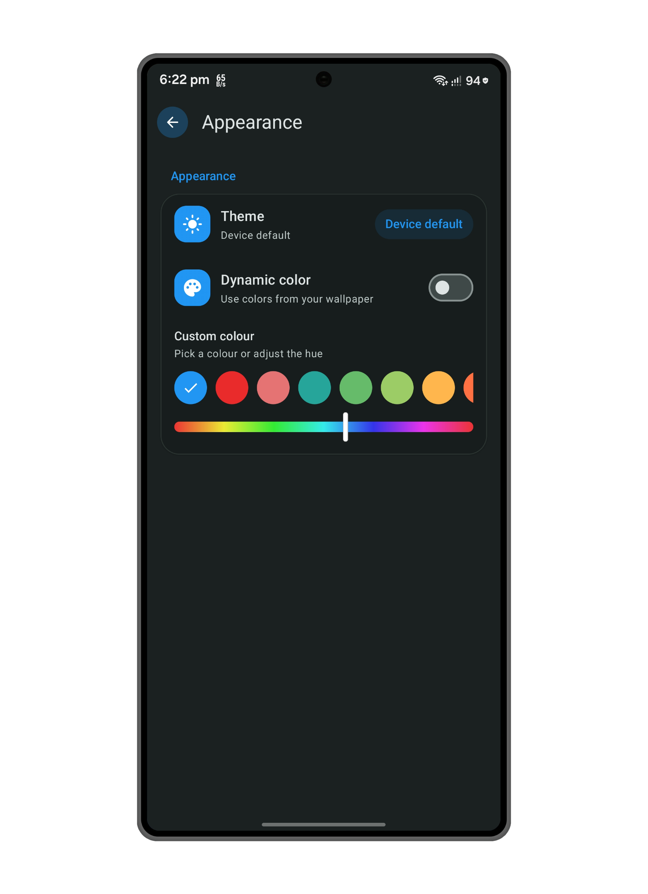
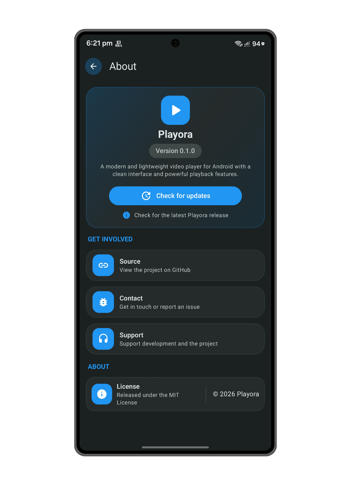

<p align="center">
  
</p>

<p align="center">
  A modern, powerful, and private video player for Android built with Jetpack Compose and AndroidX Media3.
</p>

<p align="center">
  
  
  
  <br>
  
  
  <a href="https://github.com/Darkstar085/Playora/actions/workflows/release.yml"></a>
  
</p>

---

## 📸 Screenshots

<p align="center">
  
  
  
</p>
<p align="center">
  
  
  
</p>
<p align="center">
  
  
  
</p>

---

## ✨ Features

### 🎬 Playback Engine & Decoder Modes
- **Media3 ExoPlayer & NextLib Extended** — Robust video playback engine supporting all popular audio and video formats (MP4, MKV, WebM, AVI, TS, FLV, and more).
- **Multiple Decoder Modes** — Switch flexibly between **Hardware (HW)**, **Hardware Plus (HW+)**, and **Software (FFmpeg)** decoding modes.
- **Smart Decoder Recovery** — Automatic fallback and recovery handling when encountering unsupported or corrupted codecs.
- **Background & PiP Playback** — Continue listening with background audio playback via foreground service or keep watching with Picture-in-Picture (PiP) mode.
- **Aspect Ratio & Zoom Controls** — Fit to screen, Stretch, Crop/Zoom, 100%, 16:9, and 4:3 with visual on-screen feedback.
- **Chapter Support & Playlists** — Navigate embedded video chapters, automatic playlist generation, and continuous playback.
- **External Intent Support** — Play videos directly from external file managers, browsers, or other apps via `ACTION_VIEW` and `ACTION_SEND`.

### 👆 Intuitive Gesture Controls
- **Vertical Swipes** — Swipe vertically on the left side for brightness and on the right side for volume.
- **Horizontal Swipe** — Smooth scrubbing and seeking through media with timeline preview.
- **Double Tap** — Double-tap left/right edges to seek backward/forward or center to play/pause.
- **Pinch-to-Zoom** — Dynamic multi-touch pinch gestures to zoom and inspect video content.
- **Immersive Playback** — Automatic system bar hiding for a distraction-free viewing experience.

### 💬 Subtitles & Multi-Audio
- **Broad Subtitle Format Support** — Embedded and external subtitles including `.srt`, `.vtt`, `.ass`, `.ssa`, `.ttml`, and `.sub`.
- **Subtitle Styling & Encoding** — Customizable font size, colors, text background, and encoding detection.
- **Subtitle Delay & Speed** — Real-time subtitle sync adjustment and speed calibration.
- **Multi-Track Audio** — Switch effortlessly between multiple embedded audio tracks with optional audio boost.

### 📁 Smart Media Library
- **Multiple View Modes** — Browse videos by **Folder Tree**, **Folders**, or flat **Videos** list.
- **Responsive Layouts** — Toggle between **List** and **Grid** views via Quick Settings.
- **Optimized List Layout** — Clean 2-line wrapped folder titles for full movie and TV series names, compact thumbnail art, and inline video count & size.
- **Fast Sorting & Filtering** — Sort by Name, Date Modified, File Size, or Duration in Ascending/Descending order.
- **Missing Metadata Recovery** — Automatic extraction of missing video thumbnails, durations, and dimensions.
- **Batch Management** — Multi-select items to play in queue, share, copy, move, mark as watched/finished, or delete (with Trash support).

### 🔒 Privacy Locker (Secret Vault)
- **Built-in Vault** — Keep sensitive videos and folders hidden from your main library and other apps.
- **Biometric & PIN Authentication** — Protect your hidden vault with Fingerprint/Face Unlock or a secure 4-digit PIN.
- **Seamless Hiding Flow** — Easily hide or restore items directly from the media library.

### 🎨 Material 3 Expressive UI & Customization
- **Dynamic Theming** — Full Material 3 Expressive design with Monet dynamic color extraction on Android 12+.
- **Custom App Icons** — 14 curated launcher icon themes (Amber, Blue, Coral, Cyan, Deep Orange, Green, Indigo, Red, Teal, and more).
- **Quick Settings Sheet** — Instant access to view mode, layout, sorting, and field visibility toggles.
- **Backup & Restore** — Export and import your customized app and player preferences.

### 🔄 In-App Updater & Offline-First
- **GitHub Release Updater** — Check for the latest releases directly within the app.
- **100% Offline & Private** — Zero trackers, no analytics, no telemetry, and no unnecessary network permissions.

---

## 🧰 Tech Stack

| Area | Technology |
|---|---|
| **Language** | Kotlin 2.4.21, Java 17 |
| **Android Target** | Min API 31 (Android 12), Target / Compile API 37 |
| **Build System** | Gradle 9.9.0, Android Gradle Plugin 9.5.2, KSP 2.3.14 |
| **UI Framework** | Jetpack Compose (BOM 2026.09.00), Material 3 1.5.0, Compose Navigation 3 |
| **Media Engine** | AndroidX Media3 1.11.1 (ExoPlayer, Session, UI), NextLib Extended 1.1.0 |
| **Dependency Injection** | Koin 4.2.2 (Core, Android, Compose ViewModel, Annotations) |
| **Local Persistence** | Room 2.8.5, DataStore Core 1.3.0 |
| **Concurrency** | Kotlin Coroutines & Flow 1.11.0 |
| **Image Loading** | Coil 3.6.3 (Video Frame Decoder) |
| **Serialization** | Kotlinx Serialization 1.13.0 |

---

## 🗂️ Project Structure

```text
.
├── .github/
│   ├── badges/                         # Release download badges
│   ├── scripts/                        # Release automation scripts
│   └── workflows/                      # CI/CD workflows (build, release, badges)
├── app/
│   ├── build.gradle.kts                # App dependencies and build settings
│   └── src/
│       ├── main/
│       │   ├── AndroidManifest.xml
│       │   ├── res/                    # Drawables, launcher icons, strings, themes
│       │   └── kotlin/com/sipun/playora/
│       │       ├── MainActivity.kt
│       │       ├── PlayoraApplication.kt
│       │       ├── core/
│       │       │   ├── common/         # Utilities, service bindings, context helpers
│       │       │   ├── data/           # Repositories and data mappers
│       │       │   ├── database/       # Room database, entities, and DAOs
│       │       │   ├── datastore/      # DataStore serializers and preferences
│       │       │   ├── domain/         # Media scan and sorting use cases
│       │       │   ├── media/          # MediaStore query runners & synchronizers
│       │       │   ├── model/          # Models, preference enums, and video states
│       │       │   └── ui/             # Reusable design system components and theme
│       │       ├── feature/
│       │       │   ├── player/         # Media3 player engine, gestures, PiP, service
│       │       │   ├── settings/       # Appearance, gestures, decoder, about screens
│       │       │   └── videopicker/    # Media browsing, search, and privacy vault
│       │       └── navigation/         # Navigation graph and transitions
│       └── test/                       # Unit tests
├── gradle/
│   └── libs.versions.toml              # Centralized dependency version catalog
├── build.gradle.kts
├── settings.gradle.kts
└── README.md
```

---

## 🚀 Quick Start

### Prerequisites
- Android Studio Ladybug / Meerkat or newer
- JDK 17
- Android SDK 37

### Building from Source

```bash
# Clone the repository
git clone https://github.com/Darkstar085/Playora.git
cd Playora

# Build Debug APK
./gradlew assembleDebug
```

The generated APK will be located at:
`app/build/outputs/apk/debug/app-debug.apk`

---

## 📦 Releases

Download the latest stable APK from the [Releases](https://github.com/Darkstar085/Playora/releases) page.

---

## 🔐 Permissions

Playora operates offline and only requests permissions essential for local media functionality:

- `READ_MEDIA_VIDEO` / `READ_EXTERNAL_STORAGE` — Scan and index local video files and folders.
- `USE_BIOMETRIC` — Authenticate access to the private media locker.
- `FOREGROUND_SERVICE` & `FOREGROUND_SERVICE_MEDIA_PLAYBACK` — Continuous background audio playback and notification controls.
- `POST_NOTIFICATIONS` — Display media playback controls in the system notification shade.

---

## 🙏 Inspiration & Credits

Playora is inspired by and takes design and architectural cues from:

- **[Next Player](https://github.com/anilbeesetti/nextplayer)** by **[Anil Beesetti](https://github.com/anilbeesetti)** — A fantastic open-source Android video player. We are grateful for their work in the open-source Android media playback ecosystem.

---

## 📄 License

Playora is licensed under the [MIT License](LICENSE).

---

<p align="center">
  <strong>Playora</strong> &bull; Crafted with ❤️ for smooth, private, and powerful video playback.
</p>
